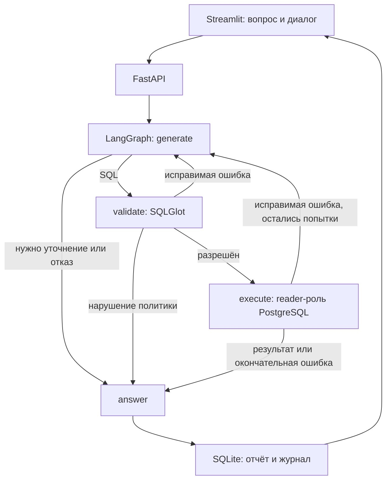

# Архитектура и данные

## Ответственность компонентов

- `providers.py`: DemoProvider или внешний LLM с обязательной схемой Plan. Модель выбирает query, clarify либо refuse, возвращает SQL и рекомендуемый график.
- `agent.py`: граф LangGraph, счётчик попыток, ветвление, обработка ошибок, формирование ответа. Всего не более трёх вызовов планировщика на один вопрос.
- `security.py`: независимая от LLM политика синтаксического дерева. После проверки SQL пересобирается из AST.
- `db.py`: повторная проверка SQL непосредственно перед выполнением, проверка прав роли, read-only транзакция, EXPLAIN, timeout и ограничение результата.
- `audit.py`: локальная история в SQLite. Она отделена от аналитической БД: право записи в журнал не даёт агенту прав изменения кредитных данных.
- `api.py`: HTTP-контракт, ограничение двух одновременно обрабатываемых вопросов, экспорт и проверка SQL без выполнения.
- `streamlit_app.py`: чат, таблицы, графики, просмотр SQL и журнала, отдельный экран каталога.

Используется один агентный граф с отдельными шагами, а не несколько одновременно работающих языковых моделей. Его поведение зависит от статуса плана, проверок и исполнения. Журнал хранит действия и ошибки, а не скрытые рассуждения модели.

## Контракт copilot_data

| Объект | Содержание |
|---|---|
| accounts | ID счёта и владельца, регион, дата открытия |
| loans | ID кредита, счёт, регион, дата выдачи, первоначальная сумма, срок, договорной платёж, A/B/C/D |
| applications | ID заявки, счёт, дата данных, сумма, результат правил, нагрузка, score/версия модели, время проверки, режим данных |
| rule_checks | Заявка, код правила, passed/failed/unknown, причина |
| dataset | Режим, дата среза, описание источника |

В самостоятельном режиме это таблицы с синтетическими fixtures. В интеграционном режиме — представления над первым проектом. Клиентский код, агент и политика используют один контракт в обоих случаях. Номеров карт, ФИО, паспортов и банковских секретов в контракте нет.

Синтетический набор намеренно небольшой и фиксированный: 24 счёта/кредита, 32 заявки, 64 проверки. Модельные оценки в нём — явно обозначенные искусственные значения, а не результаты обучения.

## Бизнес-смысл

Сумма кредита — сумма при выдаче, не текущий остаток. A/B — завершившиеся договоры; C/D — текущие состояния на момент наблюдения. Доля B среди A/B не является годовой PD. `checks_passed` не означает банковское одобрение. Нагрузка основана на заявленных данных, а NULL не заменяется нулём.

У набора нет последовательности исторических снимков риска или остатков. Поэтому вопрос «Как изменился риск портфеля?» требует уточнения. Можно показать выдачи по месяцам или журнал проверок, но нельзя выдавать их за подтверждённую динамику риска.

## Контекст диалога

В запрос планировщику попадают последние шесть вопросов, статусы и текст уточнений. Результаты SQL и числовые ответы в контекст не включаются. Новый UUID диалога начинает отдельную историю. Это локальное разделение диалогов, не полноценная система аутентификации пользователей.

Финальный текст строится детерминированно: одиночная строка перечисляет фактические значения; множество строк сопровождается таблицей; пустой и усечённый результаты обозначаются явно. Это предотвращает добавление моделью неподтверждённых чисел, но не гарантирует, что сгенерированный SELECT верно понял бизнес-вопрос.

## API

| Путь | Назначение |
|---|---|
| GET /health | Подключение и допустимость reader-роли |
| GET /config | Режимы, каталог, словарь, примеры и ограничения; без секретов |
| POST /ask | Вопрос и необязательный conversation_id; возвращает отчёт запуска |
| GET /conversations/{uuid} | Последние 30 запусков выбранного диалога |
| GET /runs/{uuid} | Полный отчёт |
| GET /runs/{uuid}/csv | Таблица с указанием источника и режима провайдера |
| POST /sql/check | Статическая проверка без выполнения |

Откройте `/docs` для входных схем. Порты 8001/8502 не конфликтуют с 8000/8501 первого проекта.
